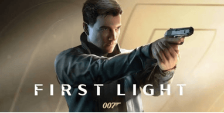

# 007 First Light The Bond Origin Story

007 First Light is **IO Interactive's** origin story for a young James Bond. The studio behind the Hitman series mixes stealth sandbox levels with big, cinematic spy action.

---

## Background

> "Stealth sandboxes plus the James Bond fantasy equals serious potential."

The game follows Bond before he becomes the 007 we know, using IOI's Glacier engine.

- Developer: **IO Interactive**
- Platforms: **PC, PS5, Xbox Series X|S** (Switch 2 version in development)
- Release date: **May 27, 2026**
- Often described as "**Hitman meets Uncharted**"

---

## 007 First Light Timeline

| Period     | Event                                       | Notes                                    |
|------------|---------------------------------------------|------------------------------------------|
| 2012       | Last major Bond game releases               | About 14 years without a new one         |
| 2020       | IOI announces a new Bond project            | Early development                        |
| 2025       | 007 First Light revealed with a new young Bond | Origin story                          |
| May 27, 2026 | Game releases                             | Delayed from March 2026                  |
| June 2026  | Reviews praise the story and tone           | Metacritic score of 88 on PS5            |

---

## The Game

| Feature        | Details                                              |
|----------------|------------------------------------------------------|
| Genre          | Action-Adventure / Stealth                           |
| Gameplay       | Open stealth levels, shooting, fistfights, gadgets   |
| Inspirations   | Hitman and Uncharted                                 |
| My Rating      | 8.5/10                                            |
| Critic Score   | 83 (predicted)                                       |
| User Score     | 8.2 (predicted)                                      |

---

## The Good and the Bad

**The Good**
- Captures the James Bond tone and spy-movie spectacle
- Blends Hitman-style stealth sandboxes with Uncharted-style blockbuster action
- Strong story, memorable characters, and a well-received new 007
- Open levels with freedom in how you tackle objectives

**The Bad**
- Pacing issues in some stretches
- Less replayable and less deep than the Hitman games
- Some awkward cutscene transitions
- Performance problems in quality mode on some platforms

---

## Conclusion

007 First Light shows that IO Interactive was the right studio for Bond. It is not perfect, but it is one of the best Bond games ever made.

> "The name's Bond. Game of the Year contender."

---