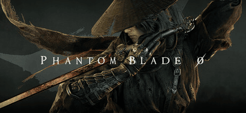

# Phantom Blade Zero The Dark Horse of 2026

Phantom Blade Zero is a stylish wuxia action RPG from the Chinese studio **S-Game**. It combines fast kung-fu combat with a dark, mysterious story, and it is my dark-horse pick for Game of the Year.

---

## Background

> "A stylish wuxia action RPG with fluid, Sekiro-esque combat."

You play **Soul**, an elite assassin who has only **66 days** to live and wants revenge on those who betrayed him.

- Developer: **S-Game**
- Platforms: **PS5** and **PC**
- Release date: **October 29, 2026**
- Style: "Kung-fu punk" action RPG

---

## Phantom Blade Zero Timeline

| Period         | Event                                           | Notes                                |
|----------------|-------------------------------------------------|--------------------------------------|
| May 2023       | First shown at the PlayStation Showcase         | Instant buzz                         |
| 2024–2025      | Hands-on previews at major game events          | Combat impressed players             |
| Dec 2025       | Release date announced at The Game Awards       | Originally September 9, 2026         |
| 2026           | Release moved to October 29, 2026               | More time to polish                  |
| Oct 2026       | Reviews go live                                 | Around 88 on Metacritic, 91 on OpenCritic |

---

## The Game

| Feature        | Details                                              |
|----------------|------------------------------------------------------|
| Genre          | Action RPG (Wuxia)                                   |
| Combat         | Fast parries, dodges, and chained strikes            |
| Weapons        | 30+ primary weapons                                  |
| My Rating      |  9/10                                              |
| Critic Score   | 87 (predicted)                                       |
| User Score     | 8.8 (predicted)                                      |

---

## The Good and the Bad

**The Good**
- Fast, fluid kung-fu combat built on parries, dodges, and chained strikes
- Memorable, challenging boss fights
- A huge variety of weapons to experiment with
- Gorgeous locations and strong art direction

**The Bad**
- Confusing, hard-to-follow storytelling
- Frame rate drops during some boss fights and in certain areas
- Difficulty balance feels uneven across modes
- Fairly linear level design

---

## Conclusion

Phantom Blade Zero might not have the budget of the biggest blockbusters, but its combat is among the best of the year, and that is why it is my dark horse for GOTY.

> "Sixty-six days to live. Zero wasted moves." ⚔️

---