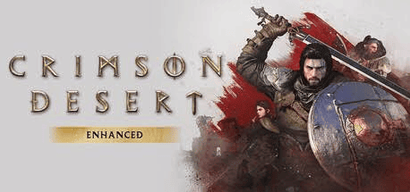

# Crimson Desert A Massive Open-World Epic

Crimson Desert is an open-world action RPG from **Pearl Abyss**, the studio behind Black Desert. It is a huge, beautiful single-player adventure that divided critics but impressed many players.

---

## Background

> "Massive scale and Beautiful visuals."

Crimson Desert began life with MMO roots and became a single-player adventure set in the medieval fantasy world of **Pywel**.

- Developer: **Pearl Abyss**
- Platforms: **PC, PS5, Xbox Series X|S**
- Release date: **March 19, 2026**
- Playstyle: Offline single-player with no online multiplayer

---

## Crimson Desert Timeline

| Period        | Event                                           | Notes                                |
|---------------|-------------------------------------------------|--------------------------------------|
| Early reveals | Announced with an MMO-style focus               | Long wait for fans                   |
| Later years   | Reshaped into a single-player open-world RPG    | Combat and exploration became the focus |
| Mar 18–19, 2026 | Reviews and launch                            | Very mixed to very positive scores   |
| Post-launch   | Updates aim to fix bugs and quality-of-life issues | Ongoing                           |

---

## The Game

| Feature        | Details                                              |
|----------------|------------------------------------------------------|
| Genre          | Open-World Action RPG                                |
| Length         | 100+ hours for main story and extras                 |
| Strengths      | Exploration, visuals, combat options                 |
| My Rating      |  8.5/10                                            |
| Critic Score   | 81 (predicted)                                       |
| User Score     | 8.0 (predicted)                                      |

---

## The Good and the Bad

**The Good**
- Enormous open world packed with activities, quests, and secrets
- Stunning visuals and excellent audio
- Deep, satisfying combat with lots of weapon and gear options
- Hundreds of hours of content and player freedom

**The Bad**
- Steep learning curve and a control scheme that can feel overwhelming
- Weak, disjointed story and narrative
- Bugs and rough edges, with quality-of-life problems at launch
- Very divisive reviews, with scores ranging from poor to near-perfect

---

## Conclusion

Crimson Desert is messy and ambitious, but it is also one of the most absorbing worlds of the year. If you have patience for rough edges, it rewards you with a lot of freedom.

> "Chaotic, ambitious, and impossible to ignore." 

---