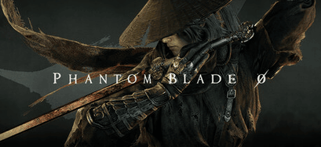
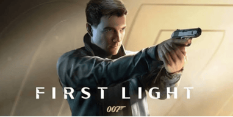
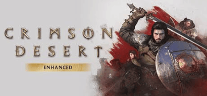
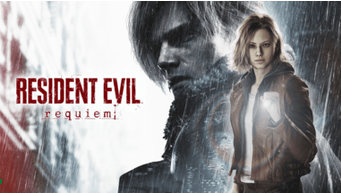

# 🎮 My Top 5 Games of 2026 — GOTY Contenders

A simple website/repository project covering my personal Top 5 Game of the Year contenders for 2026 with what I think the user and critic scores would be.

---

## 1. Project Overview

This repository contains a list of my **Top 5 Games of 2026** watchlist. The site highlights five major releases, personal ratings, critic/user scores, release details, and my GOTY prediction.

| Item | Details |
|------|---------|
| Project Name | GOTY 2026 Contenders |
| Topic | Top 5 games of 2026 |
| Sections | 5 |
| Includes | Images, tables, ratings, predictions |

---

## 2. The Top 5 Contenders

| # | Game | Genre | Release Window | Status |
|---|------|-------|----------------|--------|
| 1 | Grand Theft Auto VI | Open-World Action | Nov 19, 2026 | Upcoming |
| 2 | Phantom Blade Zero | Action RPG (Wuxia) | Oct 29, 2026 | Upcoming |
| 3 | 007 First Light | Action-Adventure / Stealth | May 27, 2026 | Upcoming |
| 4 | Crimson Desert | Open-World Action RPG | Mar 19, 2026 | Upcoming |
| 5 | Resident Evil Requiem | Survival Horror | Feb 27, 2026 | Upcoming |

---

## 3. Ratings Table (Fictional Scores)

| Game | Critic Score | User Score | My Rating (out of 10) |
|------|--------------|------------|------------------------|
| Grand Theft Auto VI | 96 | 9.3 |  10.0 |
| Phantom Blade Zero | 87 | 8.8 |  9.0 |
| 007 First Light | 83 | 8.2 |  8.5 |
| Crimson Desert | 81 | 8.0 | 8.5 |
| Resident Evil Requiem | 91 | 9.0 |  9.5 |

---

## 4. Game Highlights & Images

### Grand Theft Auto VI —  10/10

The biggest entertainment launch of the decade. Rockstar's return to Leonida could redefine open-world gaming entirely.

**✅ The Good**
- Vice City and the wider state of Leonida as a huge, modern open-world setting
- Dual protagonists, Jason and Lucia, promise a story built around a duo
- Rockstar's track record for world detail, writing, and polish
- Visuals that look like a true next-gen showcase

**❌ The Bad**
- Delayed twice already, which adds a lot of pressure to deliver
- Console-only at launch (PS5 and Xbox Series X|S), with PC likely a year or more away
- Price is 100 dollars a lot people do not want to spend 100 dollars
- Hype is so high that almost anything short of perfect could feel like a letdown

### Phantom Blade Zero —  9/10

A stylish wuxia action RPG with fluid, Sekiro-esque combat. A serious dark-horse GOTY pick.

**✅ The Good**
- Fast, fluid kung-fu combat built on parries, dodges, and chained strikes
- Memorable, challenging boss fights
- A huge variety of weapons to experiment with
- Gorgeous locations and strong art direction

**❌ The Bad**
- Confusing, hard-to-follow storytelling
- Frame rate drops during some boss fights and in certain areas
- Difficulty balance feels uneven across modes
- Fairly linear level design

### 007 First Light — ⭐ 8.5/10

IO Interactive's Bond origin story. Stealth sandboxes plus the James Bond fantasy equals serious potential.

**✅ The Good**
- Captures the James Bond tone and spy-movie spectacle
- Blends Hitman-style stealth sandboxes with Uncharted-style blockbuster action
- Strong story, memorable characters, and a well-received new 007
- Open levels with freedom in how you tackle objectives

**❌ The Bad**
- Pacing issues in some stretches
- Less replayable and less deep than the Hitman games
- Some awkward cutscene transitions
- Performance problems in quality mode on some platforms

### Crimson Desert —  8.5/10

Pearl Abyss's sprawling open-world epic. Massive scale and gorgeous visuals.

**✅ The Good**
- Enormous open world packed with activities, quests, and secrets
- Stunning visuals and excellent audio
- Deep, satisfying combat with lots of weapon and gear options
- Hundreds of hours of content and player freedom

**❌ The Bad**
- Steep learning curve and a control scheme that can feel overwhelming
- Weak, disjointed story and narrative
- Bugs and rough edges, with quality-of-life problems at launch
- Very divisive reviews, with scores ranging from poor to near-perfect

### Resident Evil Requiem —  9.5/10

Horror royalty returns. Grace Ashcroft's story could be the franchise's most ambitious entry yet.

**✅ The Good**
- Switching between Grace (tense survival horror) and Leon (action) keeps things fresh
- Excellent gunplay, with strong puzzles and exploration
- Top-tier audio, visuals, and voice acting
- Plenty of nostalgic callbacks for longtime fans

**❌ The Bad**
- The story is uneven and can swing from engaging to goofy
- The action-heavy second half is less compelling than the horror
- Grace gets little character development
- Heavy on fan service, which may overwhelm newcomers

---

## 5. GOTY Prediction & Summary

| Ranking | Game | Critic Score | User Score | My Rating |
|---------|------|--------------|------------|-----------|
| 🥇 | Grand Theft Auto VI | 96 | 9.3 | 10/10 |
| 🥈 | Resident Evil Requiem | 91 | 9.0 | 9.5/10 |
| 🥉 | Phantom Blade Zero | 87 | 8.8 | 9/10 |
| 4 | 007 First Light | 83 | 8.2 | 8.5/10 |
| 5 | Crimson Desert | 81 | 8.0 | 8.5/10 |

| Summary Category | Details |
|------------------|---------|
| Total Games | 5 |
| Highest Critic Score | Grand Theft Auto VI (96) |
| Highest User Score | Grand Theft Auto VI (9.3) |
| Highest My Rating | Grand Theft Auto VI (10/10) |
| Lowest Rated | Crimson Desert (81 critic / 8.0 user) |
| Most Anticipated | Grand Theft Auto VI |
| Dark Horse Pick | Phantom Blade Zero |

---